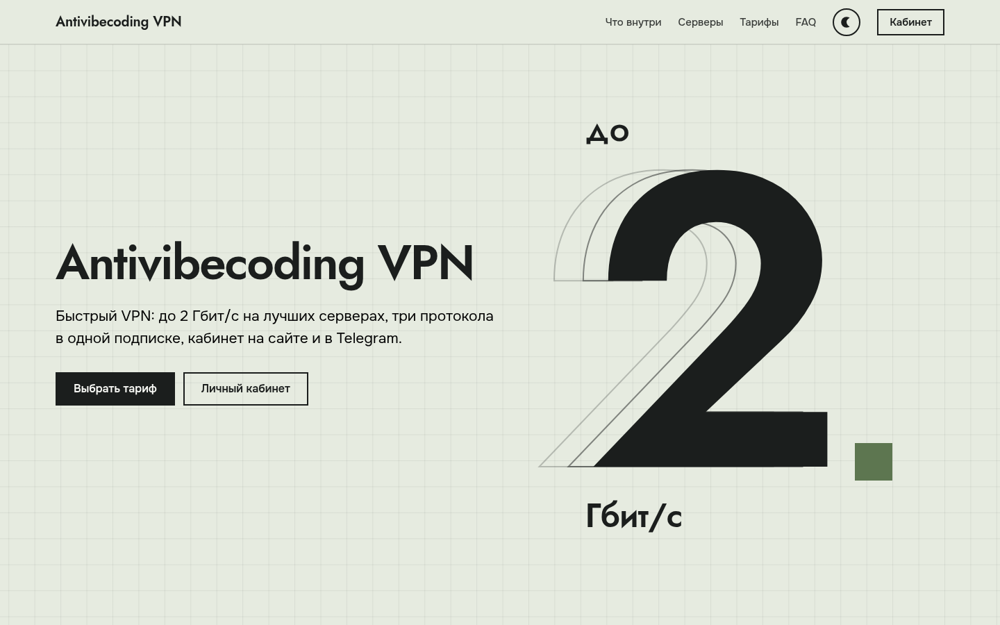

<div align="center">

# avv-card

**The Antivibecoding VPN landing page: fast, light, framework-free**

[](LICENSE)


[Русский](README.md) · [Live site](https://general.substituteme.space/) · [Third-party notices](NOTICE.md)



</div>

## What it is

A one-page static site: what the service offers, the countries of its servers, tariffs and an FAQ.
No bundler and no framework: HTML, one CSS file, one JS file and a little data.

- **Light**: about 100 KB on first load (HTML + CSS + JS is ~20 KB gzipped).
- **Smooth**: scroll effects run in one `requestAnimationFrame`, all layout reads first and all writes after.
- **Two themes**, honours `prefers-color-scheme` and `prefers-reduced-motion`.
- **Live data** from `data.json`, refreshed by `refresh.mjs`; the visitor's browser never talks to the backend.
- **Safe by default**: data text goes through `textContent`, links are built through the DOM, and `refresh.mjs` validates the response and keeps the previous file on anything unexpected.

## Layout

```
public/                      site root: this is what the web server serves
├── index.html
├── css/style.css
├── js/app.js, js/content.js
├── data/data.json           public tariffs and country codes (sample data here)
└── assets/{fonts,flags,img}
scripts/refresh.mjs          rebuilds data.json from the backend API (Node 18+)
docs/                        README previews
licenses/                    full third-party licence texts
```

## Run

No build step, any static server works:

```bash
python3 -m http.server 8080 -d public
```

Edit `public/js/content.js` for your links (`cabinetUrl`, `botUrl`) and the `popularKey` tariff.

## Data

`data.json` holds the public tariff terms and country codes (the sample in this repo has `"sample": true`).
`scripts/refresh.mjs` (Node 18+, no dependencies) rebuilds it from your backend's `GET /client/v1/tariffs` and `GET /client/v1/servers`:

```bash
CORE_CLIENT_URL=http://127.0.0.1:9546 \
CORE_CLIENT_TOKEN_FILE=/path/to/read-only.token \
CARD_DATA_OUT=./public/data/data.json \
node scripts/refresh.mjs
```

The token is read from a file, the backend URL must be `https` or loopback, the response is capped at 64 KB and type-checked, and an empty or malformed answer leaves the previous `data.json` untouched. Give the job a read-only token for these two endpoints only.

## Deploy

Any static host or nginx. Recommended: long immutable caching for `assets/` and `?v=` files, short caching for `index.html` and `data.json`, gzip/brotli for text assets, HTTPS with HSTS, and a Content-Security-Policy (the single inline theme script in `index.html` needs a hash). Bump the `?v=` query in `index.html` when you change `js/app.js`, `css/style.css` or `js/content.js` (serve the `public/` folder).

## Licences

Project code: [MIT](LICENSE). Flags ([flag-icons](https://github.com/lipis/flag-icons), MIT) and fonts ([Onest](https://github.com/googlefonts/onest), [Jost](https://github.com/indestructible-type/Jost), SIL OFL 1.1) keep their authors' licences: see [NOTICE.md](NOTICE.md) and [`licenses/`](licenses/).

The Antivibecoding VPN name, brand and the service/bot addresses in `public/js/content.js` belong to the project; replace them when you fork.
