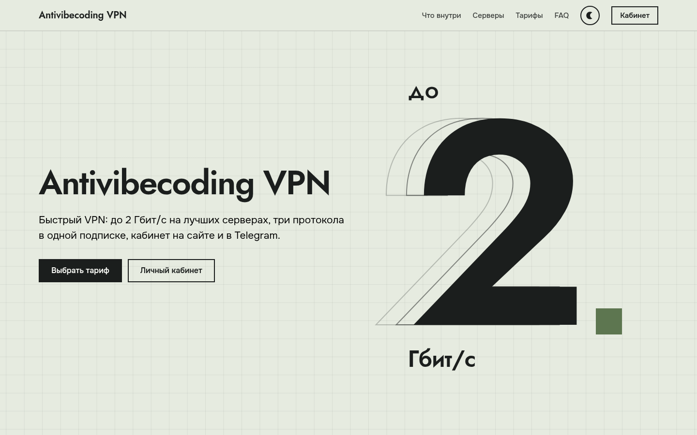
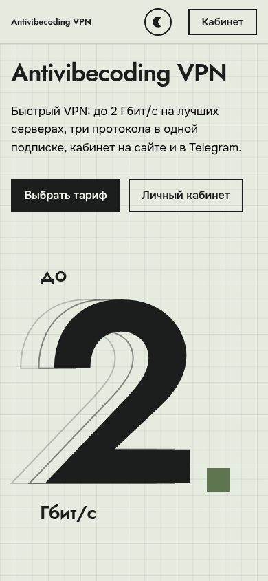

<div align="center">

# avv-card

**Сайт-визитка Antivibecoding VPN: быстрый, лёгкий, без фреймворков**

[](LICENSE)


[English](README.en.md) · [Живой сайт](https://general.substituteme.space/) · [Лицензии третьих сторон](NOTICE.md)



</div>

## Что это

Одностраничный статический сайт: что умеет сервис, список стран серверов, тарифы и FAQ.
Никакого сборщика и фреймворка: HTML, один CSS, один JS и немного данных.

- **Лёгкий.** Первая загрузка около 100 КБ: HTML, CSS и JS вместе ~20 КБ в gzip, остальное шрифты и флаги.
- **Плавный.** Скролл-эффекты считаются в одном `requestAnimationFrame`: сначала все чтения layout, потом все записи, без лишних пересчётов.
- **Две темы** (светлая и тёмная), уважает `prefers-color-scheme` и `prefers-reduced-motion`.
- **Живые данные.** Тарифы и страны подтягиваются из `data.json`, который обновляет `refresh.mjs`. Браузер посетителя к бэкенду не обращается.
- **Безопасно по умолчанию.** Тексты из данных идут через `textContent`, ссылки строятся через DOM, а `refresh.mjs` проверяет ответ и при любой странности оставляет прежний файл.

<div align="center">

</div>

## Структура

```
public/                      корень сайта: его и отдаёт веб-сервер
├── index.html               разметка и мета-теги (Open Graph, Twitter Card)
├── css/style.css            стили и тёмная тема
├── js/
│   ├── app.js               анимации, рендер тарифов и стран, переключатель темы
│   └── content.js           ссылки (кабинет, бот) и запасные данные, пока нет data.json
├── data/data.json           публичные данные: тарифы и коды стран (пример с "sample": true)
└── assets/
    ├── fonts/               Onest и Jost, woff2 (кириллица и латиница)
    ├── flags/               флаги стран (flag-icons, см. NOTICE.md)
    └── img/                 og.png и favicon.svg
scripts/refresh.mjs          обновляет data.json из API бэкенда (Node 18+, без зависимостей)
docs/                        превью для README
licenses/                    полные тексты лицензий третьих сторон
LICENSE · NOTICE.md          лицензия проекта и уведомления о сторонних компонентах
```

## Запуск

Сборки нет, достаточно любого статического сервера:

```bash
python3 -m http.server 8080 -d public
# открыть http://localhost:8080
```

Подстройте под себя `public/js/content.js`: ссылку на кабинет (`cabinetUrl`), бота (`botUrl`), ключ «самого популярного» тарифа (`popularKey`).

## Откуда берутся данные

Страница читает `data.json` и перечитывает его раз в `refreshMinutes`. Формат:

```json
{
  "updated_at": "2026-11-08T12:00:00Z",
  "tariffs": [
    { "id": 1, "key": "start", "name": "Старт", "price_stars": 100, "duration_days": 30,
      "quotas": [{ "type": "lifetime", "limit_bytes": 214748364800 }] }
  ],
  "countries": ["de", "fi", "nl"]
}
```

`refresh.mjs` обновляет файл из API вашего бэкенда. Он ждёт ответ вида `{ "tariffs": [...] }` от `GET /client/v1/tariffs` и `{ "servers": [{ "country_code": "de" }] }` от `GET /client/v1/servers` и пишет только то, что должно быть публичным: условия тарифов и коды стран.

```bash
CORE_CLIENT_URL=http://127.0.0.1:9546 \
CORE_CLIENT_TOKEN_FILE=/path/to/read-only.token \
CARD_DATA_OUT=./public/data/data.json \
node scripts/refresh.mjs
```

Что делает скрипт для безопасности:

- токен читается из файла и уходит только в заголовок `Authorization`, в логи и ошибки не попадает;
- адрес бэкенда должен быть `https` или loopback;
- ответ не больше 64 КБ, поля проверяются по типам и длине;
- пустой или неожиданный ответ **не затирает** прежний `data.json`: скрипт завершается с ошибкой;
- запись атомарная (временный файл и `rename`).

Для запуска по расписанию подойдёт systemd-таймер или cron. Дайте сервису токен **только на чтение** этих двух ручек и право записи в одну папку с данными.

## Развёртывание

Любой статический хостинг или nginx. Что стоит настроить:

- `Cache-Control: public, max-age=31536000, immutable` для `assets/` и файлов с `?v=` (`css/`, `js/`); короткий кеш для `index.html` и `data.json`;
- gzip или brotli для `text/css`, `application/javascript`, `image/svg+xml` и `application/json`;
- HTTPS и заголовки `Strict-Transport-Security`, `X-Content-Type-Options: nosniff`, `X-Frame-Options: DENY`;
- желательна Content-Security-Policy (в `index.html` есть один inline-скрипт выбора темы, ему нужен хэш).

Страница Terra лежит в `public/terra.html`; чтобы она открывалась без `.html`, добавьте в nginx `location = /terra { try_files /terra.html =404; }` и перенаправление с `/terra.html` на `/terra`.

При изменении `js/app.js`, `css/style.css` или `js/content.js` поднимайте `?v=` в `index.html`. Веб-серверу отдавайте папку `public/`.

## Лицензии

Код проекта: [MIT](LICENSE). Флаги ([flag-icons](https://github.com/lipis/flag-icons), MIT) и шрифты ([Onest](https://github.com/googlefonts/onest) и [Jost](https://github.com/indestructible-type/Jost), SIL OFL 1.1) распространяются на условиях их авторов: подробности и полные тексты в [NOTICE.md](NOTICE.md) и папке [`licenses/`](licenses/).

Название и бренд Antivibecoding VPN, адреса сервиса и бота в `public/js/content.js` принадлежат проекту: при форке замените их своими.
